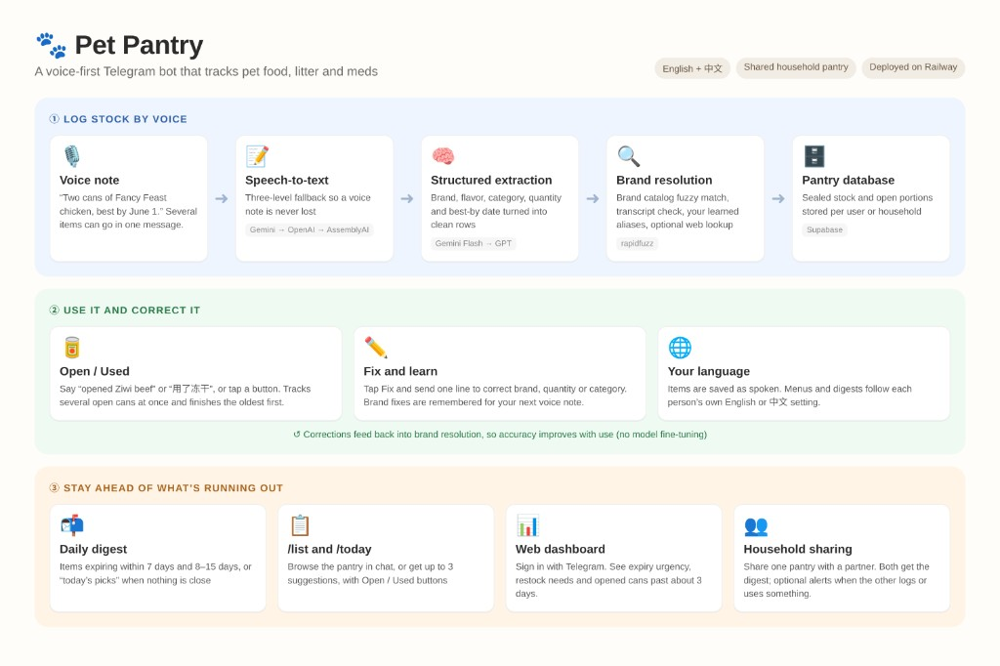
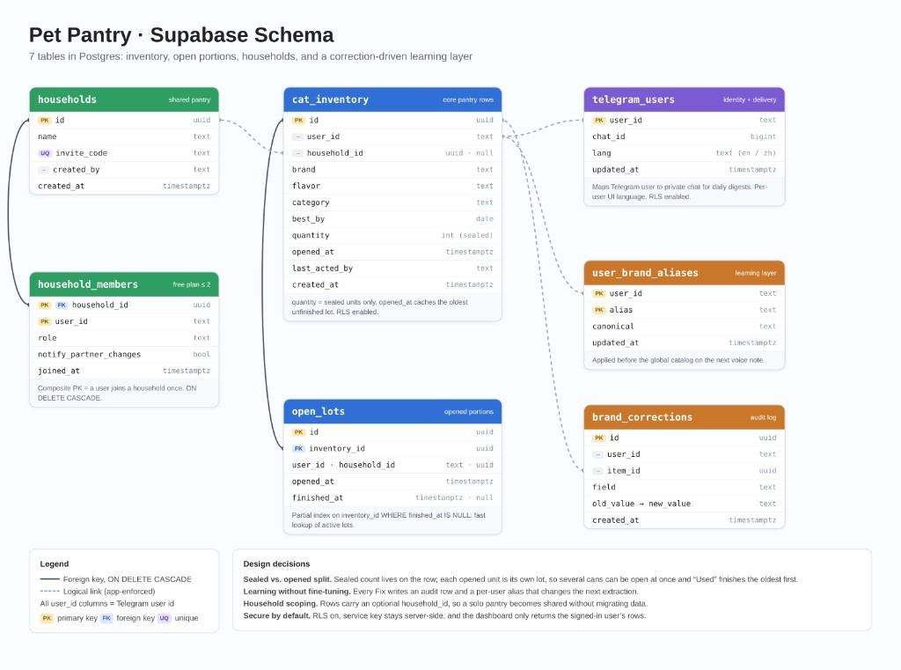
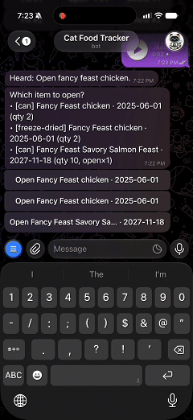

# Pet Pantry

> **Pet Pantry** is a voice-first Telegram bot that tracks pet food, litter and meds in English and Chinese. I designed, built and deployed it end to end, and it's in daily use in my own household.



### Why I built it
Pet supplies are bought in bulk, opened at different times and expire on different dates, so it's easy to waste food or run out. Typing every item into a spreadsheet is tedious, so Pet Pantry lets you log stock in one natural voice note and reminds you what to use first.

### What it does
- **Log by voice:** say "two cans of Fancy Feast chicken, best by June 1" and get structured rows; several items per message.
- **Reliable AI pipeline:** speech-to-text falls back from Gemini to OpenAI to AssemblyAI; extraction falls back from Gemini Flash to GPT.
- **Gets smarter with use:** every **Fix** is saved as a per-user brand alias and applied before the global catalog, with no model fine-tuning.
- **Tracks real usage:** sealed stock and opened portions are tracked separately, so several cans can be open at once and "Used" finishes the oldest first.
- **Stays ahead:** a daily digest of what's expiring (or "today's picks"), a Telegram-login web dashboard, and a shared pantry for two people.

### Data model


### Results
- In daily use since [month year]; [X] items logged.
- Voice-to-saved-row accuracy: [X]% on a [X]-case test set (see evals, coming soon).
- 15 test files with all external APIs mocked (`pytest -q`).

### Demo

<table>
  <tr>
    <td align="center" width="50%"><br/>Log by voice</td>
    <td align="center" width="50%"><br/>Open / disambiguate</td>
  </tr>
</table>

---
*Developer and deployment docs below. End-user guide: [USER_MANUAL.md](USER_MANUAL.md).*

## Features

- **Webhook or polling**: Telegram updates via webhook (`main.py`) or `run_polling.py`
- **Voice logging**: Multi-item extract; categories 冻干 / 罐头 / 汤包 / 猫条 / 零食 / 猫砂 / 药品 (no forced wet-food default); meds → `flavor`
- **Brand resolution**: Catalog fuzzy + transcript substring; optional Google CSE web fallback; per-user aliases from **Fix**
- **Open / Used + `open_lots`**: Open = sealed qty −1 + open lot; Used finishes oldest open lot first, else sealed −1. Voice/text: “opened X” / “开了 X”, “used X” / “用了 X”
- **`/list` / `/pantry`**: Browse up to 12 pantry rows in Telegram with Open/Used buttons
- **`/today` + eat-today digest**: If nothing near expiry, daily cron suggests top 3 eatable (open lots first)
- **Expiry digest**: 0–7 and 8–N days with inline Used buttons
- **Household (free ≤2)**: `/household` `/join` `/leave`; digests to all; `/notify on|off` for partner change pings
- **Web dashboard**: Telegram Login; urgency radar, restock, kitchen strip; Open/Used; ZH/EN UI; open shelf (罐头/汤包 ≈ 3 days)

## Project Structure

```
telegram-bot/
├── main.py                 # FastAPI app, webhook, commands, consume match
├── run_polling.py          # Local/dev long-polling entry
├── dashboard_routes.py     # /dashboard + auth + inventory APIs
├── static/dashboard/       # Inventory UI (Telegram Login)
├── data/
│   └── cat_food_brands.json
├── services/
│   ├── ai_pipeline.py
│   ├── consume_intent.py   # open/used intent from transcript/text
│   ├── inventory_match.py  # match pantry + eat-today ranking
│   ├── open_shelf_life.py
│   ├── household_service.py
│   ├── product_category.py
│   ├── brand_*.py / gemini / openai / assemblyai / supabase / telegram …
├── send_reminders.py       # Daily cron: expiry or eat-today
├── USER_MANUAL.md          # Non-technical user guide
├── requirements.txt
├── .env.example
└── README.md
```

## Tests

No live Telegram / Gemini / OpenAI / Supabase calls. From this directory:

```bash
pip install -r requirements.txt
pytest -q
```

Coverage includes inventory JSON parsing, brand catalog fuzzy/transcript match, category normalization, AI provider fallback, and FastAPI `/health` + webhook routing (mocked).

## Setup

### 1. Create Supabase table

Run this SQL in your Supabase SQL editor:

```sql
CREATE TABLE cat_inventory (
  id UUID PRIMARY KEY DEFAULT gen_random_uuid(),
  user_id TEXT NOT NULL,
  brand TEXT NOT NULL DEFAULT '',
  flavor TEXT NOT NULL DEFAULT '',
  category TEXT NOT NULL DEFAULT '',
  best_by DATE,
  quantity INTEGER NOT NULL DEFAULT 0,
  opened_at TIMESTAMPTZ,
  created_at TIMESTAMPTZ NOT NULL DEFAULT NOW()
);

-- Existing projects: add category (冻干/罐头/汤包/猫条/零食/猫砂/药品)
ALTER TABLE cat_inventory
  ADD COLUMN IF NOT EXISTS category TEXT NOT NULL DEFAULT '';

-- Open −1 stamps when a lot was opened (for after-open shelf life)
ALTER TABLE cat_inventory
  ADD COLUMN IF NOT EXISTS opened_at TIMESTAMPTZ;

-- Optional: drop legacy column if you added it for old per-offset reminders
-- ALTER TABLE cat_inventory DROP COLUMN IF EXISTS reminded_offsets;

-- Map Telegram user_id to private chat_id for proactive reminders
CREATE TABLE IF NOT EXISTS telegram_users (
  user_id TEXT PRIMARY KEY,
  chat_id BIGINT NOT NULL,
  lang TEXT NOT NULL DEFAULT 'en',
  updated_at TIMESTAMPTZ NOT NULL DEFAULT NOW()
);

-- Existing projects: per-user UI language (en default; independent of household)
ALTER TABLE telegram_users
  ADD COLUMN IF NOT EXISTS lang TEXT NOT NULL DEFAULT 'en';

-- Optional: RLS policies (adjust as needed)
ALTER TABLE cat_inventory ENABLE ROW LEVEL SECURITY;
ALTER TABLE telegram_users ENABLE ROW LEVEL SECURITY;

CREATE POLICY "Service role has full access"
  ON cat_inventory FOR ALL
  USING (true)
  WITH CHECK (true);

CREATE POLICY "Service role has full access"
  ON telegram_users FOR ALL
  USING (true)
  WITH CHECK (true);

-- Training layer: user corrections teach brand aliases for future voice notes
CREATE TABLE IF NOT EXISTS user_brand_aliases (
  user_id TEXT NOT NULL,
  alias TEXT NOT NULL,
  canonical TEXT NOT NULL,
  updated_at TIMESTAMPTZ NOT NULL DEFAULT NOW(),
  PRIMARY KEY (user_id, alias)
);

CREATE TABLE IF NOT EXISTS brand_corrections (
  id UUID PRIMARY KEY DEFAULT gen_random_uuid(),
  user_id TEXT NOT NULL,
  item_id UUID,
  field TEXT NOT NULL DEFAULT 'brand',
  old_value TEXT NOT NULL DEFAULT '',
  new_value TEXT NOT NULL DEFAULT '',
  created_at TIMESTAMPTZ NOT NULL DEFAULT NOW()
);

-- Household sharing (free plan: 2 members; digest always to both)
CREATE TABLE IF NOT EXISTS households (
  id UUID PRIMARY KEY DEFAULT gen_random_uuid(),
  name TEXT NOT NULL DEFAULT 'Pet Pantry',
  invite_code TEXT UNIQUE NOT NULL,
  created_by TEXT NOT NULL,
  created_at TIMESTAMPTZ NOT NULL DEFAULT NOW()
);
CREATE TABLE IF NOT EXISTS household_members (
  household_id UUID NOT NULL REFERENCES households(id) ON DELETE CASCADE,
  user_id TEXT NOT NULL,
  role TEXT NOT NULL DEFAULT 'member',
  notify_partner_changes BOOLEAN NOT NULL DEFAULT FALSE,
  joined_at TIMESTAMPTZ NOT NULL DEFAULT NOW(),
  PRIMARY KEY (household_id, user_id)
);
ALTER TABLE cat_inventory
  ADD COLUMN IF NOT EXISTS household_id UUID;
ALTER TABLE cat_inventory
  ADD COLUMN IF NOT EXISTS last_acted_by TEXT;

-- Concurrent open lots (Open = qty−1 + new lot; Used with lot = finish lot, qty unchanged)
CREATE TABLE IF NOT EXISTS open_lots (
  id UUID PRIMARY KEY DEFAULT gen_random_uuid(),
  inventory_id UUID NOT NULL REFERENCES cat_inventory(id) ON DELETE CASCADE,
  user_id TEXT NOT NULL,
  household_id UUID,
  opened_at TIMESTAMPTZ NOT NULL DEFAULT NOW(),
  finished_at TIMESTAMPTZ
);
CREATE INDEX IF NOT EXISTS open_lots_inventory_active_idx
  ON open_lots (inventory_id)
  WHERE finished_at IS NULL;
```

### Training layer (Fix)

After a voice save, tap **Fix** → send one line; the bot auto-detects:
- a **number** → quantity
- a **category** (`罐头` / `can` / `冻干` / …) → category  
- otherwise → **brand** (and learns `wrong → correct` for that user)

Or `/fix brand|quantity|category <item_id> <value>`. Category is optional (no forced wet-food default). Meds use `category=药品` and put the drug name in `flavor`.

**Open −1** = sealed `quantity − 1` + insert an `open_lots` row (cache `opened_at` = oldest unfinished lot). **Used** with an unfinished lot = finish that lot (qty unchanged); without a lot = sealed qty −1. Say “开了 XX” / “opened XX” or “用了 XX” / “used XX”, or `/today` for daily picks.

Learning is **not** fine-tuning the LLM: corrections go into `user_brand_aliases` and are applied on the next voice note *before* the global catalog / model output.

### 2. Environment variables

Copy `.env.example` to `.env` and fill in:

- `OPENAI_API_KEY` - OpenAI API key (`gpt-transcribe` + GPT extract fallback)
- `OPENAI_TRANSCRIBE_MODEL` - Default `gpt-transcribe` (`whisper-1` deprecated / shutdown 2027-02-26)
- `GEMINI_API_KEY` - Optional; when set, default STT + extract use Gemini first
- `GEMINI_TRANSCRIBE_MODEL` - Dedicated STT model (default `gemini-3.5-transcribe`)
- `GEMINI_EXTRACT_MODEL` - Chat/flash model for inventory JSON (default `gemini-2.0-flash`; do **not** use the STT model here)
- `GEMINI_MODEL` - Legacy alias for extract model if `GEMINI_EXTRACT_MODEL` unset
- `AI_TRANSCRIBE_PROVIDER` - `gemini` (default), `openai`, or `assemblyai`
- `AI_EXTRACT_PROVIDER` - `gemini` (default) or `openai`
- `ASSEMBLYAI_API_KEY` - Optional 3rd STT backup for **completed** voice files
- `ASSEMBLYAI_SPEECH_MODELS` - Default `universal-3-5-pro,universal-2` (file/async). **`universal-3-6-pro` is streaming-only** — not for Telegram OGG uploads
- `BRAND_MAP_PATH` - Optional path to brand JSON; default `data/cat_food_brands.json` under the app
- `BRAND_MATCH_THRESHOLD` - `rapidfuzz` ratio 0–100; below this, the model’s brand string is kept unchanged (default `80`, slightly more tolerant of one-letter ASR/LLM typos)
- `BRAND_WEB_SEARCH_ENABLED` - `1`/`true` to enable Google CSE + LLM brand fallback when fuzzy and transcript substring both miss the catalog (requires `GOOGLE_CSE_API_KEY`, `GOOGLE_CSE_CX`)
- `GOOGLE_CSE_API_KEY`, `GOOGLE_CSE_CX` - [Custom Search JSON API](https://developers.google.com/custom-search/v1/overview) key and search engine id
- `SUPABASE_URL` - Supabase project URL
- `SUPABASE_SERVICE_KEY` - Supabase service role key (not anon key)
- `TELEGRAM_BOT_TOKEN` - From @BotFather
- `TELEGRAM_BOT_USERNAME` - Bot username **without** `@` (required for the web dashboard Login Widget)
- `DASHBOARD_PUBLIC_URL` - Optional public HTTPS origin (no trailing slash); shown in `/start` as the dashboard link
- `REMINDER_MAX_DAYS` - Upper bound for the “8–N days” digest section (default `15`, minimum effective window is 7)
- `REMINDER_DIGEST_MAX_BUTTONS` - Max inline **Used** buttons per digest message (default `18`)

### Web dashboard (multi-user inventory)

End users open **`/dashboard`**, sign in with **Telegram Login**, and only see rows for their own Telegram `user_id`. The browser never gets `SUPABASE_SERVICE_KEY`; the FastAPI server verifies Telegram’s HMAC and sets an HttpOnly session cookie.

1. Set `TELEGRAM_BOT_USERNAME` (e.g. `cpg_tracker_bot`).
2. Deploy on **HTTPS** (Railway / etc.). Telegram Login does **not** work on plain `http://localhost` for real users.
3. In [@BotFather](https://t.me/BotFather): `/setdomain` → pick your bot → enter the host only (e.g. `your-app.up.railway.app`).
4. Optionally set `DASHBOARD_PUBLIC_URL=https://your-app.up.railway.app` so `/start` includes the link.
5. Users: open `https://…/dashboard` → Telegram Login → inventory → **Open −1** / **Used** (open-lot aware).

Local smoke-test: `python main.py` then open `http://127.0.0.1:8000/dashboard` (widget may be blocked until domain + HTTPS are set; API auth unit tests cover the HMAC path).

### Brand catalog format

Maintain a JSON array of objects with `canonical` (display name) and `aliases` (alternate spellings, local names):

```json
[
  { "canonical": "Royal Canin", "aliases": ["皇家", "皇家的", "RC"] },
  { "canonical": "Fancy Feast", "aliases": ["珍致"] }
]
```

After the LLM extracts a `brand` string, the server matches against `canonical` and `aliases` (rapidfuzz), then checks whether the **full transcript** contains any catalog alias. **Optional web fallback** (off by default): if both fail to reach `BRAND_MATCH_THRESHOLD` and you set `BRAND_WEB_SEARCH_ENABLED=1` with Google Programmable Search (`GOOGLE_CSE_API_KEY`, `GOOGLE_CSE_CX`), the bot runs **one** Custom Search + **one** short LLM call to infer an official brand name, then fuzzy-matches again. This only runs for messages where local matching failed—prefer extending `cat_food_brands.json` for common brands to save cost and latency.

**Google CSE setup (optional):** In [Google Cloud Console](https://console.cloud.google.com/) enable “Custom Search API”, create an API key. In [Programmable Search Engine](https://programmablesearchengine.google.com/) create a search engine (you can set “Search the entire web”), copy the **cx** ID into `GOOGLE_CSE_CX`.

### Fallback behavior

**Transcription** (completed Telegram voice notes):

1. `gemini-3.5-transcribe` (auto language, optional brand vocabulary hints) when `GEMINI_API_KEY` is set
2. OpenAI `gpt-transcribe` when Gemini fails / missing
3. AssemblyAI `universal-3-5-pro` (+ `universal-2` fallback) when `ASSEMBLYAI_API_KEY` is set and OpenAI fails

Note: AssemblyAI chat sometimes suggests `universal-3-6-pro` for live mic streaming. This bot uploads **finished** OGG files, so async **Universal-3.5 Pro** is the correct model.

**Extraction**: If Gemini extract raises, the bot retries with OpenAI GPT. If `GEMINI_API_KEY` is missing but providers are `gemini`, OpenAI is used with a warning.

### 3. Install and run

**Note:** Telegram voice messages use OGG/Opus format. Whisper requires MP3/WAV/etc. The bot uses `pydub` to convert OGG→MP3, which requires **ffmpeg** installed on your system.

```bash
# Install ffmpeg (required for OGG conversion)
# macOS: brew install ffmpeg
# Ubuntu: apt install ffmpeg

cd telegram-bot
python -m venv venv
source venv/bin/activate  # or `venv\Scripts\activate` on Windows
pip install -r requirements.txt
python main.py
```

### 4a. Run locally (polling mode)

For local development without a public URL:

```bash
python run_polling.py
```

This polls Telegram for updates—no webhook or ngrok needed.

### 4b. Production: Set Telegram webhook

Replace `YOUR_DOMAIN` with your public HTTPS URL:

```bash
curl "https://api.telegram.org/bot<YOUR_BOT_TOKEN>/setWebhook?url=https://YOUR_DOMAIN/webhook"
```

Then run the FastAPI server: `python main.py`

## Usage

### Single item example

1. Send a voice message to your bot describing cat food, for example:
   - English: `"Royal Canin chicken flavor, 12 cans, best by 2025-06-15"`
   - Chinese: `"皇家猫粮鸡肉口味，12 罐，保质期 2025 年 6 月 15 号"`
2. The bot transcribes, extracts data, saves to Supabase, and replies with a confirmation like:
   - `Saved: Royal Canin chicken, expires 2025-06-15, quantity 12`

### Multiple items in one message

You can describe several items in a single voice message. For example:

- Chinese:
  > 第一种是 Fancy Feast 鸡肉口味，两罐，保质期 2025 年 6 月 1 号；第二种是 Purina 三文鱼口味，三罐，保质期也是 2025 年 6 月 1 号。

- English:
  > I have two cans of Fancy Feast chicken, best by June 1st 2025, and three cans of Purina salmon, same best by date.

The bot will extract **multiple inventory rows** and save them. The confirmation might look like:

```text
Saved 2 items:
1) Fancy Feast chicken, expires 2025-06-01, quantity 2
2) Purina salmon, expires 2025-06-01, quantity 3
```

### Tips for better recognition

- Speak naturally, but keep a **rough structure**: brand → flavor → quantity → best-by date.
- You do **not** need to say explicit keywords like “brand” / “flavor”; they just make it a bit more robust.
- Dates in any language are fine; the bot will try to normalize them to `YYYY-MM-DD`.

### Expiry digest and marking items used

Schedule [`send_reminders.py`](send_reminders.py) **once per day** (Railway Cron or other scheduler) with the same `SUPABASE_*` and `TELEGRAM_BOT_TOKEN` as the bot. Each user with a `telegram_users` row receives **one message**:

- If anything is near expiry: **within 7 days** and **8–N days** (default N=15)
- Else: **Today’s picks** (up to 3 eatable items; open lots first) with Open / Used buttons

Items already past `best_by` are not listed. Set **`TZ`** (e.g. `America/Los_Angeles` or `Asia/Shanghai`) on the job so `date.today()` matches testers’ calendar.

- **Used**: finish an open lot if one exists, else sealed qty −1 (row deleted at 0 with no open lots)
- **Open**: sealed qty −1 + new `open_lots` row
- Or **`/used` / `/open` / `/today`** anytime

**Before user tests:** (1) run the `open_lots` + `telegram_users.lang` SQL above in Supabase, (2) deploy this code, (3) confirm the cron job is on, (4) BotFather `/setcommands` (paste below), (5) BotFather `/setdomain` = Railway host for Telegram Login.

```
start - How to use
help - How to use
dashboard - Open web pantry link
language - English / 中文
list - Show pantry
today - Suggest what to use today
open - Mark opened (need id)
used - Mark used (need id)
fix - Correct a recent entry
household - Shared pantry / invite code
join - Join with invite code
leave - Leave shared pantry
notify - Partner alerts on/off
cancel - Cancel Fix
```

The main bot webhook must stay deployed so callbacks and commands reach the server.

## API Endpoints

- `GET /dashboard` - Inventory web UI (Telegram Login)
- `GET /api/dashboard/config` - Public bot username for the Login Widget
- `POST /api/auth/telegram` - Verify Login Widget payload → session cookie
- `POST /api/auth/logout` - Clear session
- `GET /api/me/inventory` - Current user’s inventory
- `POST /api/me/inventory/{id}/used` - Decrement quantity (delete at 0)
- `POST /webhook` - Telegram webhook (receives updates)
- `GET /health` - Health check

## Railway deployment (ffmpeg required)

Telegram voice is OGG/Opus; this app converts to MP3 with **pydub**, which needs **ffmpeg** on the server. If ffmpeg is missing, users see transcription errors.

**Option A (recommended): Dockerfile**

The repo includes a `Dockerfile` that installs `ffmpeg`. In Railway, set the service to build with Docker (Railway auto-detects `Dockerfile` when present).

**Important:** In Railway → your service → **Settings → Deploy → Custom Start Command**, leave it **empty** so the image `CMD` runs. If you set e.g. `uvicorn ... --port $PORT` without a shell, Railway may pass the literal string `$PORT` to uvicorn, which crashes with:

`Invalid value for '--port': '$PORT' is not a valid integer`

and Telegram webhooks will show **502**.

The `Dockerfile` `CMD` uses `sh -c` so `${PORT:-8000}` expands correctly at runtime.

**Option B: Nixpacks without Docker**

If you build with Nixpacks only, the repo includes `nixpacks.toml` with `aptPkgs = ["ffmpeg"]`. Ensure Railway is not ignoring it.

After deploy, set the Telegram webhook:

```bash
curl "https://api.telegram.org/bot<YOUR_BOT_TOKEN>/setWebhook?url=https://<your-railway-domain>/webhook"
```

Use a **single-line** URL (no line breaks inside the quotes).

### If Telegram never replies and Railway shows no runtime logs

1. Open the **same Railway service** that runs `uvicorn` (not the Cron job, not Build logs). Use **Deployments → latest → Logs** (runtime / HTTP), not only **Build logs**.
2. Ensure **Public Networking** is on and you have a **Railway-generated domain** (or custom domain) for that service.
3. From your laptop, run (replace the host):

   ```bash
   curl -sS "https://YOUR-RAILWAY-DOMAIN/health"
   curl -sS "https://YOUR-RAILWAY-DOMAIN/"
   ```

   You should see JSON and, in Railway runtime logs, lines like `GET /health` and `HTTP GET /health`.

4. Confirm Telegram is calling **this** URL (must end with `/webhook`):

   ```bash
   curl -sS "https://api.telegram.org/bot<YOUR_BOT_TOKEN>/getWebhookInfo"
   ```

   Check `url` matches your Railway domain and read `last_error_message` if any.

5. If `getWebhookInfo.url` is empty or points elsewhere, set webhook again (single-line `curl`).

## Production Notes

- Use HTTPS for the webhook URL (required by Telegram)
- Install **ffmpeg** on the server for OGG→MP3 conversion (Telegram voice format)
- All I/O is async (Telegram, OpenAI, Supabase) for non-blocking performance
- Voice processing runs in background task; webhook returns 200 quickly to avoid Telegram timeout
- For expiry digests, run `send_reminders.py` daily (second Railway service or cron) with `SUPABASE_*`, `TELEGRAM_BOT_TOKEN`, and recommended **`TZ`**; ensure `telegram_users` exists and users have messaged the bot so `chat_id` is stored. **Public networking is not required** for that job (outbound-only)
- Use `SUPABASE_SERVICE_KEY` (service role) for backend; never expose it to the client
- Set `ENV=production` in production for non-reload mode
